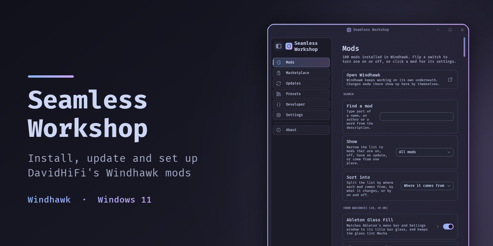

<div align="center">



# Seamless Workshop

**A Windhawk mod that installs, updates and removes every DavidHiFi Windhawk mod from one window.**

One command sets it up. From then on it keeps itself, the mods and their presets up to date.

<a href="https://github.com/DavidHiFi/seamless-workshop/releases/latest">

</a>

<br><br>


</div>

---

## Installation

Paste this into PowerShell:

```powershell
irm https://raw.githubusercontent.com/DavidHiFi/seamless-workshop/main/Install-SeamlessWorkshop.ps1 | iex
```

1. If Windhawk is missing or older than the 2.0 alpha, the script gets the latest alpha first with [windhawk-alpha-updater](https://github.com/DavidHiFi/windhawk-alpha-updater). Your mods and settings stay.
2. It downloads Seamless Workshop from the latest release and throws it away if it does not match its checksum.
3. It installs it through Windhawk's own command-line tool. Windows asks for admin rights.
4. Click the Seamless Workshop icon in the tray. To get everything, open **Updates** and choose **Apply DavidHiFi's whole setup**.

Running the command again is safe. If you already have the newest version, it says so and changes nothing.

<details>
<summary><b>Install by hand instead</b></summary>

<br>

1. Download `seamless-workshop.wh.cpp` from the [latest release](https://github.com/DavidHiFi/seamless-workshop/releases/latest) and open it in Notepad.
2. In Windhawk, click **Create a new mod**, delete the sample code and paste the file in.
3. Click **Compile and enable**, then **Exit editing mode**.

</details>

## Features

### Install and remove

- **Every DavidHiFi mod in one list:** the Updates page lists each one you do not have yet, with what it does. One click installs it.
- **The Windhawk library too:** Marketplace finds and installs any mod from Windhawk's own catalog.
- **Remove:** open a mod and choose Remove. Its settings go with it.
- **On or off:** flip a mod's switch without opening the Windhawk editor.

### Stay up to date

- **Daily check:** once a day the Workshop looks for new versions of the mods and of itself, and tells you in the tray.
- **One click:** update one mod, or all of them at once with one backup and one admin prompt.
- **Checked downloads:** every file is checked against a checksum before it installs.
- **The Workshop updates itself** from the same page.

### Presets

- **DavidHiFi's settings for one mod**, or **his whole setup in one go**.
- **Your settings are saved first** as a preset, so you can always go back.
- **Your own presets:** save a set of mods and their settings, then restore them together.

## Notes

> [!IMPORTANT]
> **Needs the Windhawk 2.0 alpha.** The install command handles this for you. On Windhawk 1.x by hand? Update with [windhawk-alpha-updater](https://github.com/DavidHiFi/windhawk-alpha-updater) first.

> [!NOTE]
> **Nothing private is shared.** Published presets never hold API keys, tokens, passwords, locations or personal folder paths. The Workshop only downloads. It never uploads your settings.

> [!WARNING]
> **Loading a preset replaces that mod's settings.** The Workshop saves your current ones as a preset first.

<details>
<summary><b>What is in this repo</b></summary>

<br>

- `feed.json`: the list the Workshop reads. It is rebuilt each time a DavidHiFi mod is published, and points at an exact commit of [davids-windhawk-mods](https://github.com/DavidHiFi/davids-windhawk-mods) with a SHA-256 checksum for every file.
- `Install-SeamlessWorkshop.ps1`: the install command above. Run it as a file with `-Check` to see what it would do without changing anything.
- `CHANGELOG.md`: what changed in each release.
- The mod itself ships as `seamless-workshop.wh.cpp` on the [releases page](https://github.com/DavidHiFi/seamless-workshop/releases). A new release goes out by itself whenever its version goes up.

</details>

## Contributing

Bug reports with your Windhawk version and a screenshot help the most, and so do mod requests.

<a href="CONTRIBUTING.md">

</a>

## Star history

Thanks for every star.

<a href="https://www.star-history.com/?repos=DavidHiFi%2Fseamless-workshop&amp;type=date">
  <picture>
    <source media="(prefers-color-scheme: dark)" srcset="https://api.star-history.com/chart?repos=DavidHiFi/seamless-workshop&amp;type=date&amp;theme=dark&amp;legend=top-left" />
    <source media="(prefers-color-scheme: light)" srcset="https://api.star-history.com/chart?repos=DavidHiFi/seamless-workshop&amp;type=date" />
    
  </picture>
</a>

## Credits

- **Author:** Myself, [DavidHiFi](https://github.com/DavidHiFi)

| Who | What |
|---|---|
| **Michael Maltsev** ([Windhawk](https://github.com/ramensoftware/windhawk)) | The mod platform, its tool-mod support and the command-line tool the installer uses. |
| **DavidHiFi** ([davids-windhawk-mods](https://github.com/DavidHiFi/davids-windhawk-mods)) | The mods, presets and settings the Workshop lists and installs. |

Built on [Windhawk](https://windhawk.net), with [Direct2D](https://learn.microsoft.com/windows/win32/direct2d/direct2d-portal), [DirectWrite](https://learn.microsoft.com/windows/win32/directwrite/direct-write-portal) and [WinHTTP](https://learn.microsoft.com/windows/win32/winhttp/about-winhttp).

> Missing or wrong credit? [Open an issue](https://github.com/DavidHiFi/seamless-workshop/issues/new) and I'll fix it.

## Disclaimers

Most of this project's code was developed with AI coding agents, including Claude Code, Codex and OpenCode. No single AI agent made the project.

Windhawk mods change how Windows looks and behaves. If something goes wrong, turn the mod off in Windhawk or start Windhawk in safe mode.

<div align="center">
<br>
<sub>Not affiliated with Ramen Software or Microsoft. Requires Windows 11 and Windhawk.</sub>
</div>
